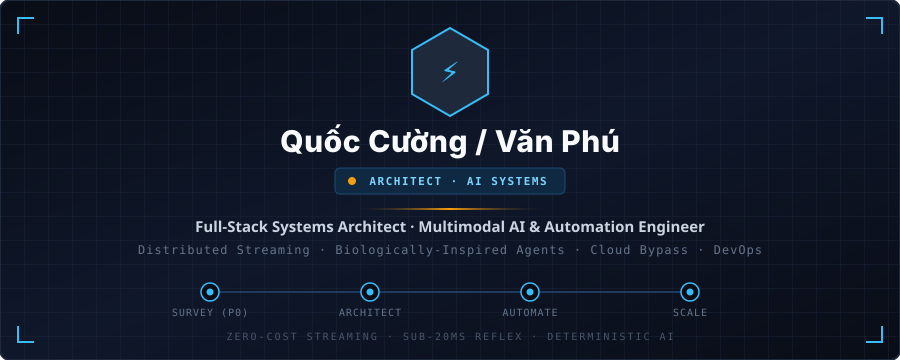
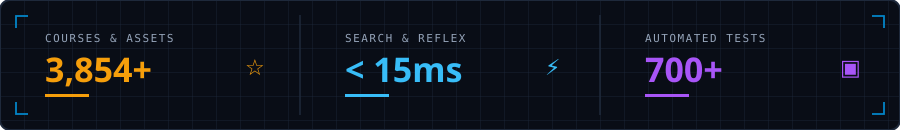

  <!-- 1. HUD BLUEPRINT HERO CARD (GIỐNG ẢNH 1) -->
  

    

  <!-- 2. CHAMFERED CYBERPUNK SOCIAL BUTTONS (GIỐNG ẢNH 1) -->
  

    
    &nbsp;
    
    &nbsp;
    
    &nbsp;
    
  

  <!-- 3. HUD BLUEPRINT METRICS PANEL (GIỐNG ẢNH 1 & 2) -->
  

    

  <!-- 4. CENTERED BIO STATEMENT (GIỐNG ẢNH 2) -->
  

    <b>Full-Stack Systems Architect &amp; Multimodal AI Engineer based in Ho Chi Minh City.</b> 
    I build real-world distributed platforms, engineer biologically-inspired autonomous AI agents, 
    automate what can be automated, and turn complex engineering bottlenecks into scalable open architectures.
  

 

## Stack

<!-- 5. L1 -> L6 BLUEPRINT STACK MATRIX (GIỐNG ẢNH 2) -->

  

 

---

## Featured Systems & Production Architectures

<!-- DỰ ÁN 1: EDUSTREAM PREMIUM -->
### `SYS_01` · 🎓 [EduStream Premium](https://edu-stream-premium.vercel.app) — Enterprise E-Learning & Zero-Cost Streaming Platform
> **Scale:** `3,854+ Courses` · `350,000+ Lessons` · `40,000+ Full HD Videos` &nbsp;|&nbsp; **Cloud Sync:** [Google Spreadsheet Catalog](https://docs.google.com/spreadsheets/d/1UHL6LnsmDZswOe6vxXd14ZkVTX_vC_OsqM5zXedTrxM/edit) &nbsp;|&nbsp; **Repo:** `vanphu1201/lms-drive-project`

<table width="100%">
  <tr>
    <td width="50%" valign="top">
      <b>⚡ Distributed Streaming &amp; Sub-15ms Search</b>
      <ul>
        <li><b>HTTP 206 Proxy &amp; 7-Layer Cache:</b> Reverse streaming proxy supporting byte-range scrubbing with 7 in-memory caches (<code>videoplaybackCache</code>, <code>activeDownloads</code> mutex, <code>userAccessCache</code>, etc.) + LRU SSD eviction.</li>
        <li><b>Google Drive Multi-Node Pool:</b> Load-balances and auto-fails over across multiple Google Cloud Service Accounts, eliminating <code>403 downloadQuotaExceeded</code> limits at <b>$0 CDN cost</b>.</li>
        <li><b>Sub-15ms Dual-Layer Search:</b> RAM index (~12MB) + SSD snapshot cache with Vietnamese NFC/NFD accent folding, stop-word filtering, and Levenshtein typo correction.</li>
        <li><b>10+ Format In-App Viewer:</b> Native PDF stream, Jupyter <code>.ipynb</code> AST renderer, Office Online embed, and 30+ language syntax IDE.</li>
      </ul>
    </td>
    <td width="50%" valign="top">
      <b>🛡️ Anti-Piracy DRM, R2 RAG Tutor &amp; 3s Funnel</b>
      <ul>
        <li><b>Fullscreen DRM Watermark:</b> Injects rotating user watermarks (Email + ID every 12s) directly into the <code>.plyr</code> DOM via React Portals &amp; <code>MutationObserver</code> (`z-index: 99999`), persisting in Native Fullscreen + blocking F12/DevTools.</li>
        <li><b>Cloudflare R2 RAG &amp; Action Protocol:</b> Gemini AI tutor queries video transcripts on R2 with exact timestamp citations and executes JSON UI commands (<code>SWITCH_LESSON</code>, <code>SET_THEME</code>, <code>BUY_ALL_COURSES</code>).</li>
        <li><b>3s VietQR SePay &amp; Gmail Drive Share:</b> Collision-resistant <code>LMSxxxxxx</code> orders with atomic MongoDB idempotency, direct <code>drive.permissions.create</code> Gmail folder sharing, and IDM/Aria2 batch script exports.</li>
        <li><b>24/7 Autonomous Social Selling:</b> Meta Graph API webhook responder, 7 AM <code>node-cron</code> AI copywriter, and instant Telegram Admin alerts.</li>
      </ul>
    </td>
  </tr>
</table>

<b>📂 Inspect all 20 Production Subsystems of EduStream Premium</b>

 

| Layer | Subsystem | Architectural Implementation |
| :--- | :--- | :--- |
| **`L1 · STREAM`** | **HTTP 206 & 7-Layer Cache** | `streamController.js` & `fileCacheManager.js`: Range chunking, mutex locks, max 3 concurrent streams/IP, SSD LRU cleanup. |
| **`L2 · POOL`** | **Multi-Node Drive Pool** | `googleManager.js`: Random healthy node selection + zero-downtime fallback on 403/429 errors across Service Accounts. |
| **`L3 · DRM`** | **Anti-Piracy Video Player** | `VideoPlayer.jsx`: React Portal watermark inside `.plyr`, 7-coordinate 12s rotation, context-menu lock, dual AI WebVTT captions. |
| **`L4 · DOCS`** | **Multi-Document & Code IDE** | `CourseClient.jsx`: Native PDF, `.ipynb` JSON parser, Word/Excel/PPTX embed, 30+ code syntax highlighters, archive inspector. |
| **`L5 · SEARCH`** | **Sub-15ms RAM + SSD Engine** | `searchEngine.js`: Dual-layer indexing, Vietnamese accent folding, +160 title / +50 category scoring, Levenshtein distance. |
| **`L6 · AI RAG`** | **R2 Transcript Tutor** | `chatbotController.js`: S3 Keep-Alive transcript fetch from Cloudflare R2, Gemini key/model rotation, JSON UI Action Protocol. |
| **`L7 · PAY`** | **3s VietQR SePay Webhook** | `paymentController.js`: 7-tier pricing matrix (299k Lifetime, 150k Category, 100k Subcategory), atomic `findOneAndUpdate` idempotency. |
| **`L8 · CLOUD`** | **Direct Gmail Drive Share** | `driveShareController.js`: Grants `role: 'reader'` directly to student Gmail via Google Drive API v3 Permissions. |
| **`L9 · BATCH`** | **Central Download Hub** | `BatchDownloadModal.jsx`: URL resolver, 4-level folder tree, tri-state checkboxes, automated **IDM & Aria2/cURL** batch scripts. |
| **`L10 · PROMO`** | **Cart, Coupon & Combos** | `couponController.js`: Percent/fixed coupons, live QR recalculation, Folder Combo value estimator (>95% discount anchoring). |
| **`L11 · TRUST`** | **Verified Buyer Reviews** | `reviewController.js`: 5-star breakdown, automated order-history verification badge, dynamic Schema.org `avgRating` sync. |
| **`L12 · TRIAL`** | **Multi-Folder Free Trial** | `trialHelper.js`: Extracts 3 trial lessons across distinct chapters while blurring & locking premium curriculum items. |
| **`L13 · STUDY`** | **Classroom Productivity** | Timestamped notes with 1-click seek, 85% auto-completion, resume playback banner, PiP mini-player, resizable split-screen. |
| **`L14 · MAIL`** | **Transactional Email Suite** | `emailService.js`: Dark-mode responsive HTML emails via Nodemailer for 6-digit crypto OTPs, welcome kits, and password resets. |
| **`L15 · META`** | **Fanpage Graph Auto-Sales** | `facebookAutoResponder.js`: Real-time comment/Messenger AI sales agent, anti-markdown formatting, dual-price upsell, Telegram alerts. |
| **`L16 · CRON`** | **7 AM Auto-Post Scheduler** | `autoPostScheduler.js`: Daily `node-cron` job selecting unposted courses, generating Gemini captions, and posting to Facebook. |
| **`L17 · TOUR`** | **"Aria" Gamified Onboarding** | `VirtualCompanionTour.jsx`: 6-quest interactive onboarding tour teaching search, streaming, and AI commands. |
| **`L18 · LOGS`** | **Real-Time Search Telemetry** | `SearchLog.js`: Non-blocking logging of query latency, zero-result keywords, typo flags, and click-through positions (CTR). |
| **`L19 · ETL`** | **Scraper & 18-Sheet ExcelJS** | `generate_pretty_excel.js`: 40-socket Keep-Alive scraper + 18-sheet styled workbook auto-synced to Google Sheets Cloud. |
| **`L20 · ADMIN`** | **Enterprise Admin Portal** | 400KB+ React portal with recursive Google Drive folder scanner (<10s ingestion), bulk pricing x10/95% tool, and AI sandbox. |

---

<!-- DỰ ÁN 2: ROBOT ASSISTANT -->
### `SYS_02` · 🤖 Biologically-Inspired Multimodal Personal AI Agent (Robot Assistant v2.5)
> **Scope:** `ESP32-S3 Firmware` · `Thalamus 3-Lane Router` · `5-Pillar Concurrency (<1s)` · `Windows-MCP` · `Dataskill 1M-Step Filter` &nbsp;|&nbsp; **Tests:** `700+ Automated Pytest Suite`

<table width="100%">
  <tr>
    <td width="50%" valign="top">
      <b>🧬 Biologically-Inspired Cognitive Architecture</b>
      <ul>
        <li><b>Thalamus 3-Lane Reflex Router (<code>JevRouter</code>):</b>
          <ul>
            <li><i>Lane 1 (Fast Reflex &lt;10ms):</i> Accent-folded regex matching for Smart Home lights, fixed URLs, and time.</li>
            <li><i>Lane 2 (Procedural Habit &lt;20ms):</i> Fires compiled <code>ParameterizedMacro</code> habits with <b>0 LLM tokens</b>.</li>
            <li><i>Lane 3 (Conscious Brain):</i> System-2 DAG planning over persistent WebSockets with a Metacognitive <b>No-Go Safety Gate</b>.</li>
          </ul>
        </li>
        <li><b>Cerebellum Motor &amp; Predictive Coding:</b> Sub-30ms coordinate micro-adjustments, Foveated Grounding (80% vision token reduction), and two-layer <code>ExpectedStateDelta</code> post-condition verification with automatic self-correction replanning.</li>
        <li><b>5-Tier Biological Memory:</b> Working, Short-Term (Redis), Episodic, Semantic (Vector), and Procedural Memory with background LLM consolidation.</li>
      </ul>
    </td>
    <td width="50%" valign="top">
      <b>⚡ 5-Pillar Concurrency Engine (&lt;1s) &amp; Hardware</b>
      <ul>
        <li><b>1. Background Non-Intrusive UIA:</b> Restores minimized/System Tray windows (<code>AttachThreadInput</code>) and invokes COM controls on a dedicated thread without stealing the physical mouse.</li>
        <li><b>2. Speculative Pipelining:</b> Pre-warm worker launches apps on <code>ENTER</code> (&lt;50ms) + multi-threaded <b>RapidOCR Pool</b> (~200ms full-screen OCR).</li>
        <li><b>3. Atomic Step Batching:</b> Vectorizes multi-step actions (<code>ComputerAction.then</code>) into a single 50ms–100ms UI burst via <code>batch_actions</code>.</li>
        <li><b>4. Parallel Multi-Agent DAG:</b> Executes <code>ComputerAgent</code>, <code>WebAgent</code> (Playwright + Browser-Use CDP), and <code>SmartHomeAgent</code> concurrently via <code>asyncio.gather</code> with fine-grained resource locks (<code>doc_builder</code>).</li>
        <li><b>5. Muscle Memory Macros:</b> Instant Zalo unread message OCR parser (&lt;1s, 0 tokens) &amp; 15-slide Executive PowerPoint builder (~50ms).</li>
      </ul>
    </td>
  </tr>
</table>

<b>📂 Inspect Hardware ESP32 Firmware, Dataskill 1M-Step Filter &amp; 12-Branch Ecosystem</b>

 

- **📊 Dataskill Non-LLM Filter (`server/skills/skill_filter.py`):** Distilled from **1,000,000 cleaned action steps** (183,333 tasks v2.1) into 25 core skills & 55 task templates (`known_skills.json`). Scores intents via $\text{Score} = 0.7 \times \text{Containment} + 0.3 \times \text{Jaccard}$ in **<5ms**, complete with dry-run simulation and financial confirmation gates.
- **🎯 Deterministic Direct Skills (`direct_skills.py`):** Bypasses multi-step LLM loops when required arguments are complete (e.g., `gmail_send`) using instant JavaScript DOM readiness probing (`ready_js`).
- **🖥️ Deep Windows-MCP & Chrome CDP Relay:** Full Windows-MCP integration (UIA/IA2 trees, Win32 hooks, visual overlays, sandboxed PowerShell, Registry, Clipboard) + Manifest V3 Chrome Extension (`chrome.debugger` WebSocket relay) operating inside the user's logged-in Chrome profile.
- **🎙️ ESP32-S3 C/C++ Firmware (`firmware/`):** ESP-IDF v5 FreeRTOS 4-state FSM (`IDLE`, `LISTENING`, `THINKING`, `SPEAKING`), I2S INMP441 mic capture, MAX98357A speaker driver, RMS Voice Activity Detection (VAD), SSD1306 I2C OLED animated face expressions, and custom 3-byte binary WebSocket protocol (`/ws/audio`) with instant **Barge-in interruption**.
- **🔄 Unified Multi-Provider Resilience:** Automatic failover cascade between OpenAI and Google Gemini (`UnifiedClient`) paired with a 60s-cooldown `GeminiKeyRotator`.

---

<!-- DỰ ÁN 3: GOOGLE DRIVE ULTRA DOWNLOADER -->
### `SYS_03` · ⚡ Google Drive Ultra Downloader & Protected-Media Bypass SaaS
> **Throughput:** `35–50 MB/s (+500% Speedup)` &nbsp;|&nbsp; **Bypass Rate:** `100% Copy-Protected Video & Retina 2K PDF` &nbsp;|&nbsp; **Billing:** `<5s VietQR Auto-Fulfillment`

<table width="100%">
  <tr>
    <td width="50%" valign="top">
      <b>🔓 Hybrid Media Bypass &amp; Cloud-to-Cloud Sync</b>
      <ul>
        <li><b>3-Stage Video Bypass Engine:</b>
          <ol>
            <li><i>API Temp-Clone:</i> Clones restricted files via Drive API v3 to strip copy locks, downloads via <b>Aria2c</b> (4–16 parallel connections, 64MB disk-cache), and auto-deletes in <code>finally</code> blocks.</li>
            <li><i>yt-dlp Cookie Core:</i> Dynamic session cookie extraction for restricted streams.</li>
            <li><i>Raw Stream Scraping:</i> Parses internal <code>/get_video_info</code> endpoints for direct <code>videoplayback</code> streams.</li>
          </ol>
        </li>
        <li><b>Retina 2K Protected PDF Scraper:</b> Automates headless Playwright Chromium (<code>deviceScaleFactor: 2.0</code>) to scroll lazy-loaded Google Viewer DOM containers, inject HTML5 <code>&lt;canvas&gt;</code> extractors, and compile lossless multi-page PDFs in RAM via <b>Pillow</b>.</li>
        <li><b>Cloud-to-Cloud OAuth2 Upload:</b> Transfers files directly to user Google Drives via 256MB resumable chunks (15–25 MB/s) using 4-worker <code>ThreadPoolExecutor</code>.</li>
      </ul>
    </td>
    <td width="50%" valign="top">
      <b>💳 Anti-Exploit Billing, Fast Zip &amp; Zero-Trust DevOps</b>
      <ul>
        <li><b>Anti-Exploit Dual Credit System:</b>
          <ul>
            <li><i>Deferred Browser Billing:</i> Atomic <code>charged.flag</code> locks prevent double-charging during IDM/HTTP Range requests.</li>
            <li><i>Upfront &amp; Auto-Refund:</i> Atomic MongoDB <code>$inc</code> deduction with instant rollback if Python subprocesses fail.</li>
          </ul>
        </li>
        <li><b>Store-Only Fast Zipping (1–3s):</b> Packages multi-file folders via native <code>zip -0</code> without CPU compression bottlenecks, streamed live over TCP-NoDelay <b>Server-Sent Events (SSE)</b>.</li>
        <li><b>Zero-Trust Docker &amp; Cloudflare Tunnel:</b> Multi-stage Docker image (Next.js 15 static export + Express 5 + Python 3.11 + Chromium) exposed via <b>Cloudflare HTTP/2 Tunnels</b> (zero open ports), 5-minute Garbage Collector (Zero Disk Leakage), and PyInstaller `.exe` desktop bundler.</li>
      </ul>
    </td>
  </tr>
</table>

---

<!-- DỰ ÁN 4 & 5: AIC VIDEO RETRIEVAL & N8N MEDIA FACTORY -->
### `SYS_04 & 05` · 🔍 Multimodal Video Retrieval (AIC) & 🎬 1-to-N Autonomous Media Factory

<table width="100%">
  <tr>
    <td width="50%" valign="top">
      <b>🔍 AIC 2026 Multimodal Video Retrieval System</b> 
      <b>Architecture:</b> Decoupled 4-Domain Micro-Modular Pipeline
      <ul>
        <li><b>Data Intelligence (`src/extraction/`, `src/indexing/`):</b> Shot boundary ingestion &amp; multimodal feature extraction across <b>Visual</b> (CLIP/SigLIP/DINOv2), <b>Audio</b> (Whisper ASR), <b>OCR</b> (TrOCR/PaddleOCR), and <b>Objects</b> (YOLO) into <b>FAISS/Qdrant</b> + <b>BM25/SQLite FTS</b>.</li>
        <li><b>Retrieval &amp; Fusion (`src/retrieval/`):</b> Natural language modality decomposition, Reciprocal Rank Fusion (RRF), soft folder priors, and negative evidence dampening.</li>
        <li><b>Temporal Localization (`src/temporal/`):</b> Sliding-window frame refinement, <b>TRAKE</b> (Trajectory &amp; Action Knowledge Extraction), and mAP/Recall@K regression benchmarks.</li>
        <li><b>Platform &amp; Contracts (`src/api/`, `src/schemas/`):</b> FastAPI backend, high-speed frame-scrubbing UI, and strict Pydantic type governance.</li>
      </ul>
    </td>
    <td width="50%" valign="top">
      <b>🎬 1-to-N Financial Media Factory (n8n + Veo 3.1 + FFmpeg)</b> 
      <b>Pipeline:</b> Web Scraping ➔ AI Director ➔ 1080p Video ➔ 4 Social Platforms
      <ul>
        <li><b>5-Node Gemini Failover Cascade:</b> Scrapes financial news and orchestrates an AI Film Director (<code>gemini-robotics-er-1.6-preview</code>) across 5 fallback keys to author continuous 10-part, 80-second scripts.</li>
        <li><b>JSON Healing &amp; Safety Sanitizer:</b> Custom regex parser repairs malformed LLM JSON outputs, replaces sensitive political/billionaire names, and appends mandatory financial disclaimers.</li>
        <li><b>Parallel Veo 3.1 &amp; Two-Stage FFmpeg Merge:</b> Dispatches 9:16 1080p video batches (<code>veo_31_fast_relaxed</code>) + 16:9 thumbnails, polls async completion barriers, and stitches clips via zero-reencode <b>FFmpeg concat demuxing (<code>-c copy</code>)</b>.</li>
        <li><b>Omnichannel Publishing &amp; Cleanup:</b> Pushes binary streams to <b>Facebook Reels, TikTok, YouTube Shorts, and Instagram</b>, followed by automated disk cleanup and self-triggering webhook loops.</li>
      </ul>
    </td>
  </tr>
</table>

---

## Deterministic AI Engineering Methodology (`P0` ➔ `P20`)

To architect massive production codebases with AI agents without architectural drift or broken modules, I enforce a **20-Stage Micro-Task Governance Protocol** (*1 Task = 1 Scoped Change = 1 Verifiable Goal = 1 Dedicated Prompt*):

<table width="100%">
  <tr>
    <td width="25%" valign="top">
      <b><code>P0–P3</code> · Survey &amp; Core</b> 
      Read-only codebase mapping, entrypoint/DB auditing, unified API envelopes, health checks, and multi-role RBAC before writing feature code.
    </td>
    <td width="25%" valign="top">
      <b><code>P4–P6</code> · AST Software Map</b> 
      Repository ingestion, AST syntax tree parsing, symbol detection, call/dependency graphs, and pre/post-change impact diffing.
    </td>
    <td width="25%" valign="top">
      <b><code>P7–P14</code> · Minimal Context &amp; Sandbox</b> 
      Decomposing requirements into DAG sub-tasks, stripping irrelevant files to feed AI minimal context, executing in resource-capped sandboxes, and running unit/regression gates.
    </td>
    <td width="25%" valign="top">
      <b><code>P15–P20</code> · Failure-Driven Learning</b> 
      Recording <i>Task ➔ Context ➔ Failed Attempt ➔ Root Cause ➔ Verified Patch</i> into a searchable Experience Repository that ranks proven solutions and avoids past pitfalls.
    </td>
  </tr>
</table>

 

<!-- 6. DEVELOPER ILLUSTRATION & CLOSING MANTRA (GIỐNG ẢNH 3) -->

  
    
  <h3><b>Build. Deploy. Monitor. Improve.</b></h3>

